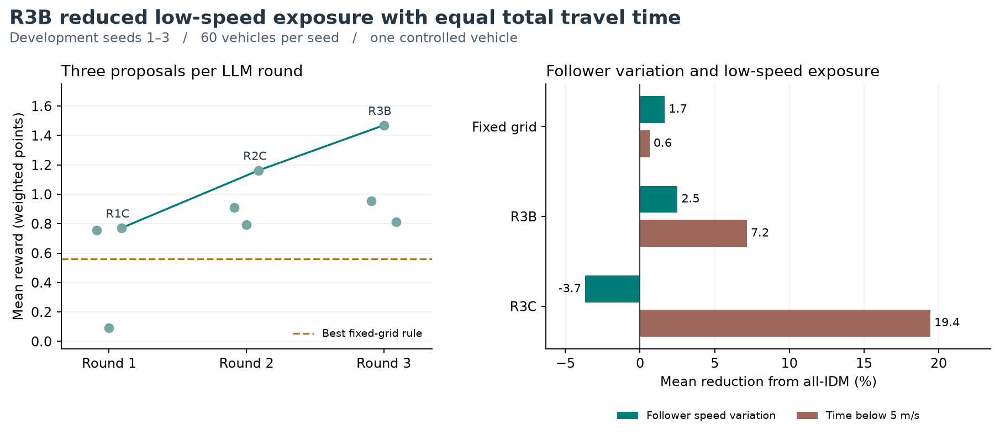
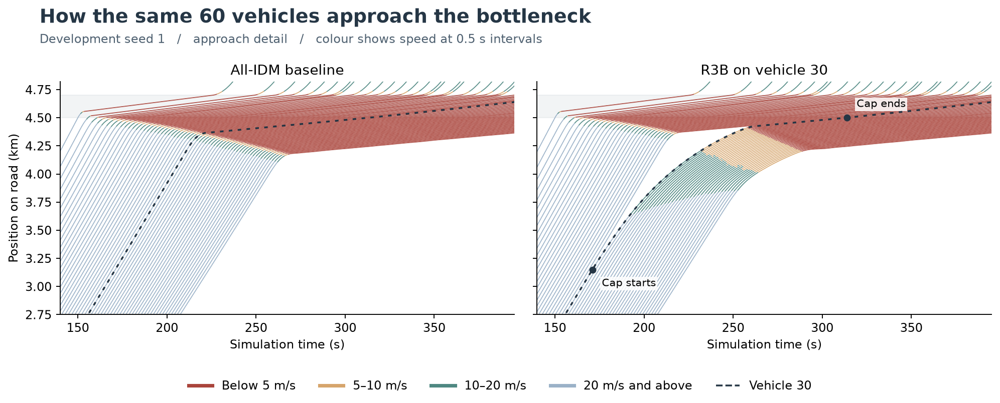

# Phase 3 · Designing a one-vehicle rule from simulation feedback

Across the three development arrival sequences, the best LLM rule (R3B) reduced speed variation for vehicles 31–40 by 2.51% and time spent below 5 m/s across all 60 vehicles by 7.16%. Total travel time and the final exit were identical to all-IDM on each seed. All 54 candidate–seed evaluations passed the full-cohort and 2 m sampled-gap requirements. Every candidate failed the stricter joint objective of improving both mean total travel time and mean follower variation.

## Who made the decisions

The student proposed benchmarking whole-cohort travel time, the final exit and low-speed congestion, with an LLM revising a single vehicle's rule after observing results. The previous stages fixed the physics, score, cohort and split. In this phase the Codex assistant selected the control grid, implemented the observation and rule interfaces, wrote the three batches of candidate tables and inspected measured feedback between batches. Python computed every metric. During driving, only one table runs on vehicle 30, once per simulated second. The LLM worked offline and its model weights stayed fixed.

The two families each used nine proposals × three matched seeds, in addition to all-IDM references and integrity replays. The predeclared control family varied constant speed and duration. The LLM family also had access to position-dependent targets, conditional release and a roadside speed signal. The observed score difference combines the effects of feedback-guided search and the richer set of available rules. [Protocol and attribution](protocol.md)

## What changed between rounds

| Selected rule | Design tested | Reward | Follower variation reduction | Low-speed exposure reduction | Total time saved | Last exit advanced |
|---|---|---:|---:|---:|---:|---:|
| All-IDM | Paired reference | 0 | 0% | 0% | 0 s | 0 s |
| H20_100 | Best of nine fixed settings | 0.562 | 1.66% | 0.64% | 0 s | 0 s |
| R1C | Trigger a bounded response using the road detector | 0.771 | 1.43% | 3.41% | 0 s | 0 s |
| R2C | Lower the desired speed progressively with position | 1.163 | 2.48% | 4.18% | 0 s | 0 s |
| R3B | Use the R2C taper when the detector first falls below 17 m/s | 1.470 | 2.51% | 7.16% | 0 s | 0 s |

Each percentage is the arithmetic mean of three within-seed reductions. A reward is a weighted sum of percentage improvements, in points. The fixed 65 s and 100 s settings differ by only 0.0000023 reward points. Their order has little practical meaning at this resolution.



R1B showed why a single proxy can mislead. Its mean low-speed exposure fell by 7.68% while follower speed variation increased by 2.25%. At 208 s in seed 1, the forward mean was 5.36 m/s while the direct leader was travelling at 26.43 m/s and the gap had grown to 169 m. The R2B follow-up used direct gap in the target and recovered a 2.31% follower-variation reduction, with a 1.01% low-speed reduction. R2C combined better values on both metrics with a gradual spatial taper.

R3B raises the five-sample detector threshold from 10 to 17 m/s. This is its only operational change from R2C. The one-shot trigger also requires the ego car to have passed 2500 m. Once active, the raw ceiling is 77 − 0.016 × position in metres, clipped to 6–23 m/s. Each decision limits the downward change to 0.55 m/s from the previous request, initially anchored to the ego speed. The intervention ends at the first decision at or beyond 4500 m or after 160 s, whichever comes first. IDM computes acceleration at 0.1 s intervals under the applicable road target.

For seed 1, this single threshold change moved activation from 185 s at 3520 m to 171 s at 3150 m. Under R3B, all 60 individual exit timestamps matched the baseline. Cumulative time below 5 m/s fell by 878.9 vehicle-seconds, about 14.6 s per scheduled vehicle on average. The trajectories show where vehicle 30 opened a gap and its followers approached more gradually. Red segments mark travel below 5 m/s. The grey band marks the 4.5–4.7 km bottleneck. The score sums vehicle-seconds at 0.1 s resolution over the whole trip. The figure shows a crop sampled every 0.5 s.



The R3C counterexample produced the largest low-speed exposure reduction, 19.45%. Follower variation increased by 3.69%. On seed 3, total travel time increased by 24.2 vehicle-seconds and the last vehicle exited 1.5 s later. Its positive mean reward (0.812) illustrates why the raw metrics and the joint objective are retained alongside the ranking.

## R3B across paired development inputs

| Seed | Reward | Follower variation reduction | Low-speed exposure reduction | Total time saved | Last exit advanced | Minimum net gap sampled | Vehicles finished |
|---|---:|---:|---:|---:|---:|---:|---:|
| 1 | 1.432 | 2.49% | 6.84% | 0 s | 0 s | 2.55 m | 60/60 |
| 2 | 1.447 | 2.36% | 7.39% | 0 s | 0 s | 2.71 m | 60/60 |
| 3 | 1.530 | 2.69% | 7.24% | 0 s | 0 s | 3.13 m | 60/60 |

The same three seeds guided revisions and selection, so generalization remains open. The monitor relies on idealized current vehicle and detector data. The 2 m check applies to discrete simulated samples. Counts below 5 m/s quantify low-speed exposure. Claims about passenger experience and wave extinction would require additional measurements.

## Experiment record

- [Decision tables and round briefs](proposals/) contain the pre-evaluation model responses, exact rule parameters and measured inputs to the following round. Git commits 5d6bbb3, a941293 and 6e2f959 save the three batches in order.
- [Development ranking](development-ranking.csv) covers every candidate. Full per-seed records retain paired raw metrics, eligibility and diagnostic braking excerpts for the [fixed grid](grid-results.json), [round 1](round1-results.json), [round 2](round2-results.json) and [round 3](round3-results.json).
- [Compressed decision traces](traces/) record every one-second observation, requested ceiling, effective target and following-interval acceleration diagnostic for each candidate. Files are UTF-8 CSV inside gzip.
- [Shortlist](shortlist.json) fixes the exact tables and SHA-256 digests for R3B, R2C, H20_100 and H20_65. Validation seeds 11–12 and test seeds 101–106 were reserved throughout development. The next stage can select one rule per family on validation before opening the test split.

## Reproduce the recorded experiment

From the repository root, use the Python environment and pinned simulator described in the main README. The following commands replay the archived decisions without requiring a model account. Generating new proposals would be a separate experiment.

```powershell
.venv/Scripts/python -m unittest -v test_evaluate test_stage3
.venv/Scripts/python stage3_search.py round1
.venv/Scripts/python stage3_search.py round2
.venv/Scripts/python stage3_search.py round3
.venv/Scripts/python stage3_search.py grid
.venv/Scripts/python stage3_report.py
```

Batch replay uses one process per seed by default. Add `--workers 1` to a search command for sequential replay. The fixed-grid case H20_30 must reproduce the original stage 2 intervention metrics on every seed. The regression suite also checks full stage 1 trajectory identity for this case on seed 1.

All ten regression checks passed in the recorded run. A second execution of all four batches reproduced the four results files and twelve compressed decision traces byte for byte in the same environment.
