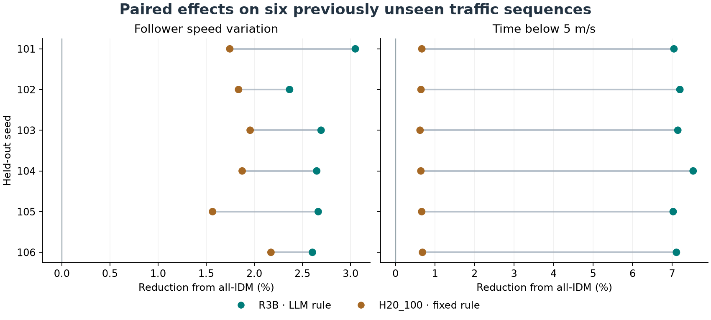
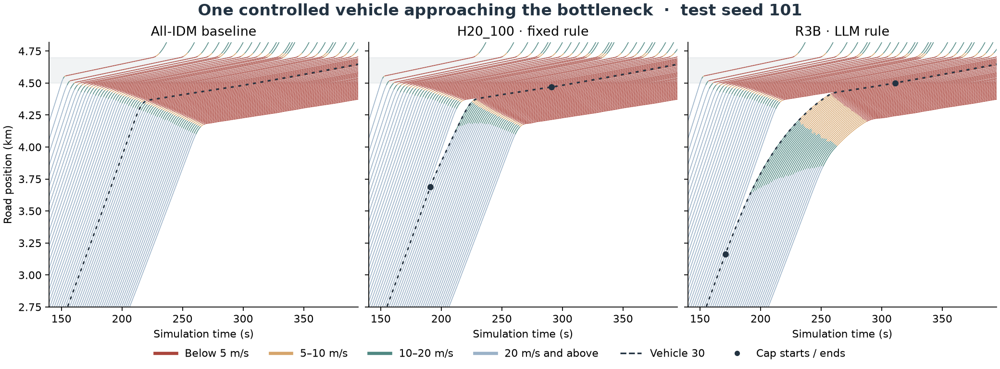

# Phase 4 · Frozen test of a single-vehicle control rule

On six held-out experiment 4 traffic sequences, the frozen LLM rule R3B reduced follower speed variation by **2.67%** and whole-cohort low-speed exposure by **7.18%** on average relative to all-IDM. Both metrics improved in all six sequences. All 360 vehicle exit timestamps matched their paired baseline timestamps at the simulator's 0.1 s resolution. The strict joint objective of reducing both total travel time and follower variation was therefore unmet.

## Validation and freeze

The [development shortlist](../stage3/shortlist.json) contained two candidates per family. Both validation seeds, 11 and 12, were used to select the eligible candidate with the highest unrounded mean reward per family. All four candidates passed both validation seeds.

| Family | Finalist | Mean validation reward | Selection |
|---|---|---:|---|
| LLM | R3B | 1.431951 | Selected |
| LLM | R2C | 1.106179 | |
| Fixed grid | H20_100 | 0.577120 | Selected |
| Fixed grid | H20_65 | 0.577117 | |

The small difference between the fixed rules is reported to six decimals to show how the prespecified ranking selected H20_100. R3B starts pacing after vehicle 30 passes 2500 m and the five-sample approach-detector mean drops below 17 m/s. It gradually lowers its desired-speed ceiling with distance. H20_100 requests a constant 20 m/s when the mean within 800 m ahead drops below 20 m/s, for up to 100 s. Both rules release by the next decision when the car reaches 4500 m. IDM updates acceleration every 0.1 s, and the LLM took part only during offline rule design.

The selection and test protocol was committed as `fe3df5f` before validation. The [freeze commit](https://github.com/4566nb/llm-traffic-control-coursework/commit/6432d52fdad6cce42869b8d197e034e169fed201) was pushed and checked on the remote before opening test seeds 101–106. It contains the [selected rules, weights, code digests and simulator version](freeze.json) and the [validation evidence](validation/). The three test arms share the same 60 scheduled arrivals, bottleneck assignments and vehicle-by-step noise for each seed. One scored run was made per arm and seed, for 18 runs in all. Six additional no-intervention checks exactly reproduced the matched baseline trajectories.

## Paired results

| Test measure | R3B | H20_100 | Seeds improved / tied / worsened vs IDM, each rule |
|---|---:|---:|---|
| Total travel time saved (vehicle-s) | 0 | 0 | 0 / 6 / 0 |
| Follower speed variation reduction | 2.67% | 1.86% | 6 / 0 / 0 |
| Low-speed exposure reduction | 7.18% | 0.65% | 6 / 0 / 0 |
| Last exit advanced (s) | 0 | 0 | 0 / 6 / 0 |
| Mean weighted reward (points) | 1.519 | 0.623 | 6 / 0 / 0 |

Each percentage is the arithmetic mean of six within-seed percentage changes. Follower variation measures cumulative absolute speed changes per kilometre for vehicles 31–40. Low-speed exposure counts time below 5 m/s for all 60 vehicles. R3B saved a mean 882.5 vehicle-seconds of low-speed travel per cohort, or 14.7 seconds per scheduled vehicle. The fixed rule saved 80.5 vehicle-seconds per cohort. Raw follower variation fell by 0.598 and 0.415 (m/s)/km respectively. Every arm finished all 60 trips in every seed. The smallest sampled net gaps across the test set were 2.76 m for all-IDM, 2.57 m for R3B and 2.49 m for H20_100, all above the frozen 2 m threshold.

| Seed | R3B follower reduction | Fixed follower reduction | R3B low-speed reduction | Fixed low-speed reduction | R3B reward | Fixed reward |
|---:|---:|---:|---:|---:|---:|---:|
| 101 | 3.05% | 1.75% | 7.05% | 0.67% | 1.620 | 0.590 |
| 102 | 2.37% | 1.84% | 7.20% | 0.65% | 1.430 | 0.616 |
| 103 | 2.69% | 1.96% | 7.14% | 0.62% | 1.523 | 0.649 |
| 104 | 2.65% | 1.87% | 7.53% | 0.64% | 1.548 | 0.627 |
| 105 | 2.66% | 1.57% | 7.03% | 0.66% | 1.502 | 0.536 |
| 106 | 2.60% | 2.17% | 7.11% | 0.68% | 1.492 | 0.720 |

## Where the change occurs

Seed 101 was selected for visualization before the test. R3B began pacing at 171 s near 3.16 km. The fixed rule began at 191 s near 3.69 km. The marked vehicle and its followers approached the queue more gradually under R3B. Time below 5 m/s fell from 12,431.2 to 11,555.2 vehicle-seconds while the last vehicle still left at 613.5 s. The three panels share axes, speed colours and the shaded bottleneck location. The stored plot samples are 0.5 s apart. Numerical scores use the complete histories at 0.1 s resolution.

The six sequences use the same simulated road, persistent bottleneck and arrival distribution. The comparison supports smoothing and reduced low-speed exposure under these conditions. The rules also differ in available structure and sensing, so the performance gap combines rule-family design and feedback-guided search. Sampled net gap is a simulation diagnostic. Transfer to other roads or bottleneck regimes would require a separate experiment with fresh scenarios.

## Evidence and reproduction

- [Raw and paired metrics, one row per arm and seed](held-out-comparison.csv) include exit counts by 400 s, sampled gaps, raw values, percentage changes and rewards. [Paired counts](paired-counts.json) show wins, ties, losses and mean physical-unit differences.
- [Test records](test/) contain all six schedules, bottleneck flags, per-vehicle exit timestamps, rule scores, one-second decision traces, and the prespecified seed 101 plot data. Each record is bound to the frozen contract digest.
- From the repository root after simulator setup, run `python stage4_report.py` to cross-check trip time and final exit against the individual timestamps, verify scores against the frozen archive and regenerate the tables and figures. This command reads the stored runs.
- To independently reproduce the original test, use a separate checkout of freeze commit `6432d52`, run `python bootstrap.py` in the pinned Python/NumPy environment and execute `python stage4_freeze.py test`. An existing complete archive is reused seed by seed. The validation command is `python stage4_freeze.py validation`.
